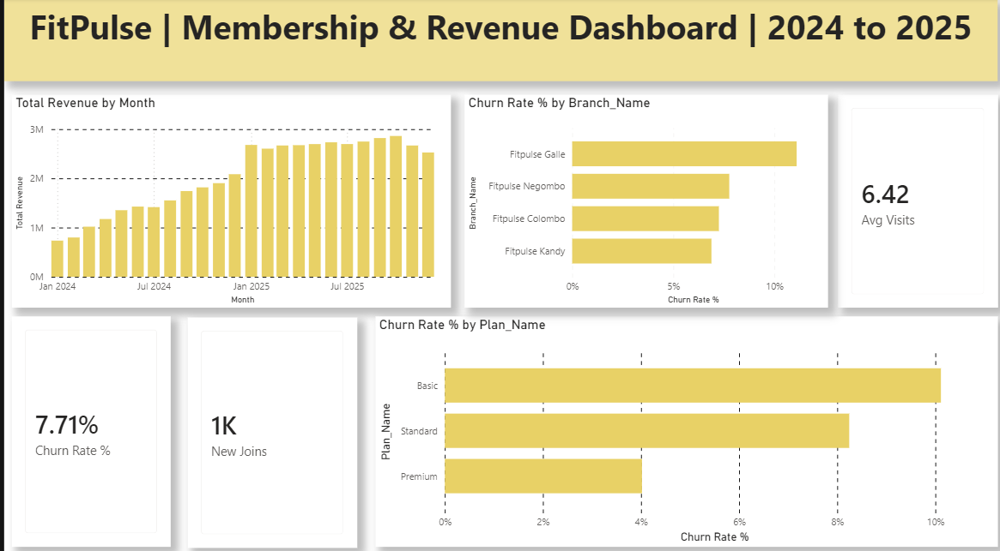

FitPulse | Membership & Revenue Dashboard (Power BI)
An interactive Power BI dashboard analysing membership, revenue and churn for FitPulse, a fictional gym chain with 4 branches across Sri Lanka. The goal was to answer the questions a gym owner actually loses sleep over: How healthy is our recurring revenue? Who is leaving, and why? Where should we act first?
> Built on a synthetic dataset I created to simulate a real subscription business (24 months, ~1,000 members). The data is fake, the analysis approach is real.

---
The business problem
A gym runs on recurring membership revenue, so churn (members cancelling) quietly eats the business from the inside. Management wanted one page that shows revenue health and, more importantly, points to where churn is coming from so they can act instead of guess.
---
Key insights
Monthly churn sits at 7.7%. Steady, but worth attacking because small churn drops compound over time.
The Basic plan is the leak. Basic members churn around 10%, while Premium churns around 4%. Longer commitments keep people in.
The Galle branch is the problem location. Its churn is clearly higher than the other three branches, which behave similarly.
Revenue is growing, roughly tripling over the two years as the member base builds, with a clear step up in early 2025.
So what: the fastest wins are fixing retention at the Galle branch and converting Basic members onto longer plans.
---
What's in the dashboard
KPI cards: Total Revenue, Active Members, Churn Rate %, Avg Visits, New Joins
Revenue by Month (trend)
Churn Rate by Branch (finds the weak location)
Churn Rate by Plan (finds the weak plan)
---
How it was built
1. Data cleaning (Power Query)
Standardised messy categorical values (gender typed 6 different ways, city names with bad casing and stray spaces).
Handled blank visit values by replacing nulls with 0 instead of deleting the rows, because those rows still held valid revenue and churn data.
Set correct data types and parsed dates with the right locale (day-first).
2. Data modelling (star schema)
1 fact table (`fact_membership_monthly`, one row per member per month) connected to 3 dimension tables (member, plan, branch) with clean one-to-many relationships.
Removed auto-detected duplicate relationships so filters flow through a single clear path.
3. Date table (DAX)
Built a dedicated calendar with `CALENDAR` + `ADDCOLUMNS` (Year, Quarter, Month Name, Month Number) and connected it to the model, so all time analysis runs off one consistent calendar.
Sorted month names by month number so charts read Jan to Dec instead of alphabetically.
4. Measures (DAX)
`Total Revenue`, `Active Members`, `Members Churned`, `Churn Rate %`, `Avg Visits`, `New Joins`.
Churn Rate uses active member-months as the denominator, so it stays consistent whether shown as a total or broken down by month, plan or branch.
---
Files in this repo
`FitPulse.pbix` — the Power BI file
`dim_member.csv`, `dim_plan.csv`, `dim_branch.csv`, `fact_membership_monthly.csv` — the dataset
`dashboard.png` — dashboard screenshot
---
Tools used
Power BI Desktop (data model, visuals)
Power Query (M) for cleaning and shaping
DAX for the date table and all measures
Star-schema dimensional modelling
---
Skills this demonstrates
Data cleaning, dimensional modelling, DAX, and subscription-metrics thinking (churn, retention, recurring revenue) that transfers to any subscription business such as SaaS, telecom or streaming.
---
Project by Mohammed Aashik · LinkedIn · Portfolio
